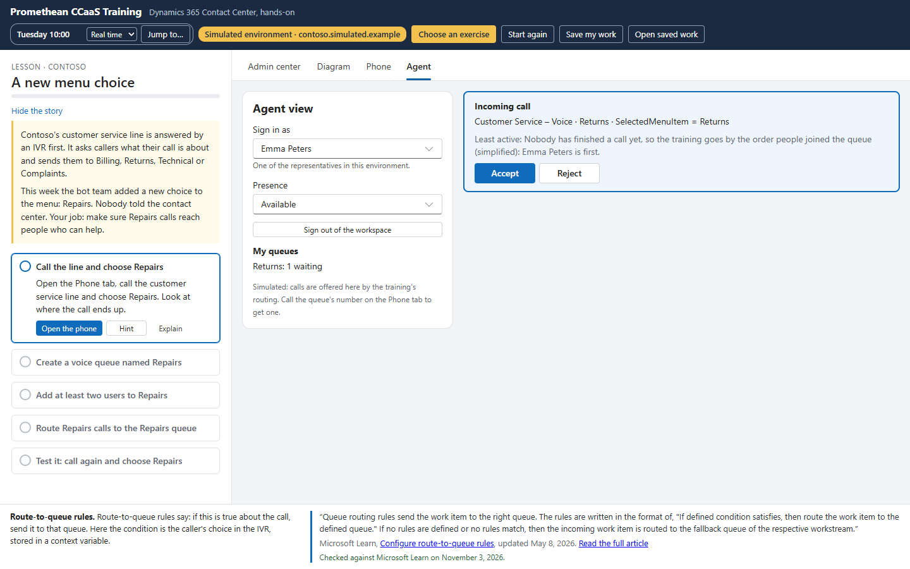
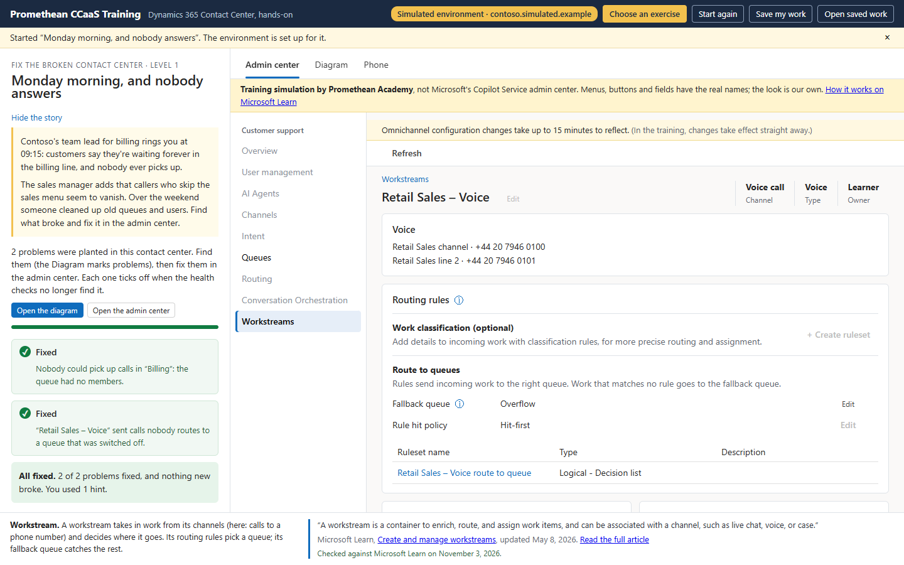
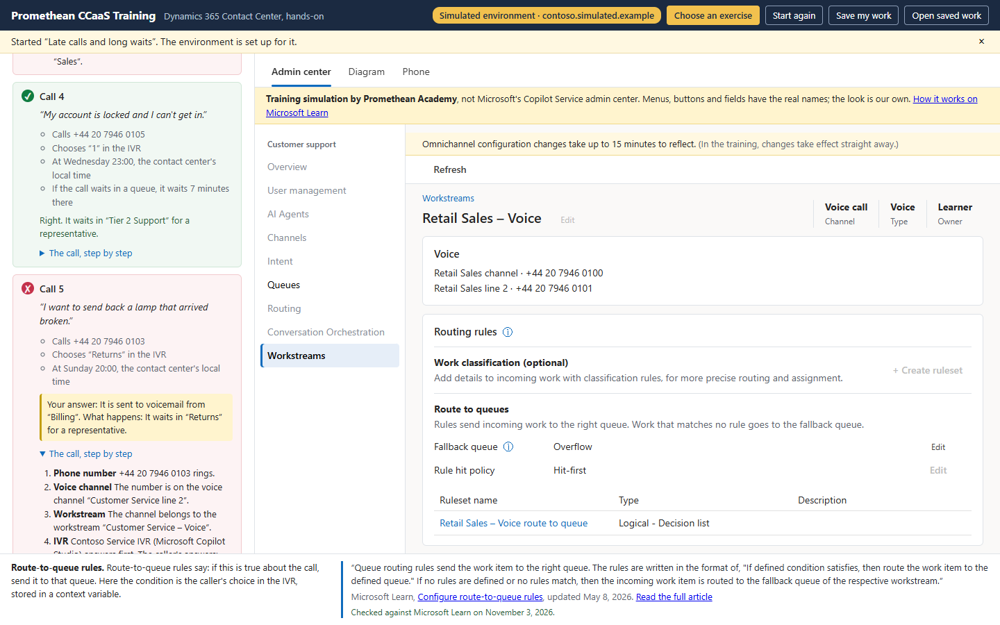
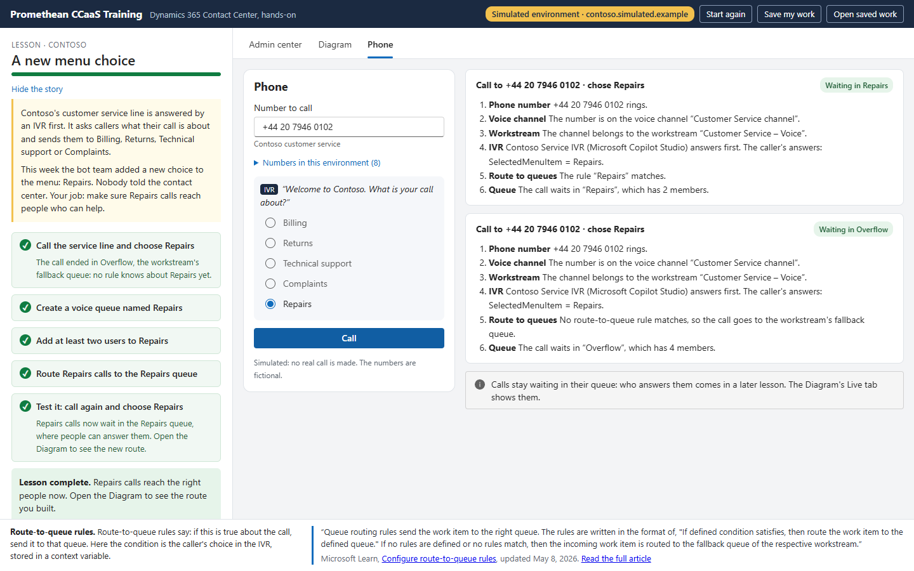
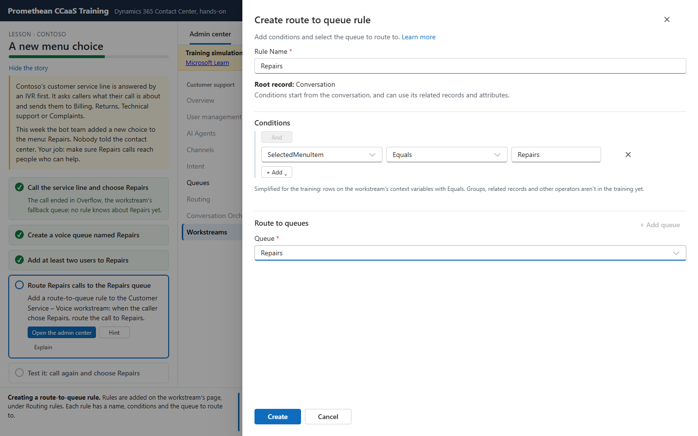

# Promethean CCaaS Training

A training app that teaches Dynamics 365 Contact Center without a Dynamics 365 environment or real phone numbers. It runs a simulated environment in the browser, with simulated phone numbers and calls, the Environment Diagram, simulated admin pages, explanations from Microsoft Learn, and AI-written scenarios.

It's built on the [Promethean CCaaS Toolbox](https://github.com/ameijers/PrometheanCCaaSToolbox), as a head start: the Toolbox's code runs underneath (its graph, health checks, routing evaluator and Environment Diagram). The training teaches Contact Center, not the Toolbox, so learners don't use the Toolbox's tools.

**Status:** all phases are built; hosting is prepared and waits for the go (docs/hosting.md). Phase 9 added the Azure Static Web Apps setup, the security and accessibility checks (docs/security.md), and Learn's license credit. Phase 8: classes with a code, a trainer's page with each learner's progress, and a guided tour (**Tour** in the header). Phase 7: two more exercise kinds, "Build to requirements" (levels 1 to 5) and "Customer interview", with new admin pages for operation hours, overflow handling, capacity profiles and new workstreams. Phase 6: calls reach representatives. A clock runs the contact center's time, routing assigns calls the way Microsoft Learn describes the assignment methods, the learner can take calls in the **Agent** tab, and new fictional numbers come from **Channels › Phone numbers**. Phase 5 is built: two kinds of exercise, "Fix the broken contact center" and "Where does this call go?", graded by code, with ready-made scenarios and AI-written ones (Claude or Azure OpenAI, checked by the training before a learner sees them). Before that: the guided lesson "A new menu choice" and explanations from Microsoft Learn. The plan and phases are in [docs/BUILD_MANUAL.md](docs/BUILD_MANUAL.md); scenarios and the AI in [docs/scenarios.md](docs/scenarios.md).











## The training screen

- **Choose an exercise** (top): the guided lesson, or a scenario ([src/scenarios/](src/scenarios/)). A scenario starts in its own environment; "Fix the broken contact center" is graded by the Toolbox's health checks, "Where does this call go?" by the call engine. See [docs/scenarios.md](docs/scenarios.md).
- **Lesson** (left, [src/lessons/](src/lessons/)): the story and the tasks. Each task has a check written as data ([checks.ts](src/lessons/checks.ts)): a row exists, a queue has members, a call ends in a queue, the learner made such a call. Code decides, not the AI. Lessons are templates in [content/lessons/](content/lessons/): each run picks its own details (phone line, new menu choice, suggested agents) from the simulated environment ([template.ts](src/lessons/template.ts)), and every variant is played through by code before a learner can get it. Small typing slips in names pass with a note; a value that would misroute a real call is explained.
- **Admin center** ([src/admin/](src/admin/)): a simulated Copilot Service admin center. It uses Microsoft's menu path, page and field names, quoted from the Learn articles listed in [content/admin-pages/pages.json](content/admin-pages/pages.json); its look is our own (Fluent UI); and a banner says it's a training simulation. It saves through the simulator's Web API ([actions.ts](src/admin/actions.ts)), with the Toolbox's tested values for queue types, assignment methods and route-to-queue rules.
- **Clock** (header, [clock.ts](src/calls/clock.ts)): the contact center's local time. It runs in real time or faster, stands still, or jumps to a day and time. Operating hours and calls use it.
- **Phone** ([src/calls/](src/calls/)): dial a number, answer the IVR, and follow the call step by step: routing rules, operating hours, overflow (voicemail, callback, transfer), and who gets the call. A call made now goes through routing to a representative ([assignment.ts](src/calls/assignment.ts), [routing.ts](src/calls/routing.ts)); a call at another time shows where it would go. With the AI on, an AI caller can call. The routing is the Toolbox's (Visual Routing Tester's model and evaluator). Each call is written as a live work item, so the Diagram's Live tab shows it.
- **Agent** ([AgentView.tsx](src/calls/AgentView.tsx)): sign in as a representative, set a presence, and accept or reject the calls routing offers, end them and close them after wrap-up. The other representatives take their calls by themselves and finish them as the clock runs.
- **Diagram**: the Toolbox's Environment Diagram on the simulated environment.
- **Learn** (bottom, [src/learn/](src/learn/)): our short summary and a passage quoted from Microsoft Learn, with the article's link and date ([content/concepts.json](content/concepts.json)). With the backend running, each passage is checked against the article as it is today; without it, the saved version shows. In the Diagram, **Open record** on a shape shows its explanation, and for a queue or workstream opens its admin page. See [docs/learn-source.md](docs/learn-source.md).

`npm run walkthrough` (with the build being served) plays the lesson in Edge by clicking and typing, and saves a screenshot of each step.

## How it works

- [src/simulator/](src/simulator/) is the simulated environment: Dataverse-shaped rows per table ([store.ts](src/simulator/store.ts)), the tables and columns ([schema.ts](src/simulator/schema.ts)), OData queries ([odata.ts](src/simulator/odata.ts)) and Web API answers ([webapi.ts](src/simulator/webapi.ts)). The shell puts `window.Xrm` and a `fetch` wrapper on the page ([xrmShim.ts](src/simulator/xrmShim.ts)), so Toolbox code reads the simulator as if it were Dataverse.
- Writes work as in Dataverse: create, update, `@odata.bind`, `$ref` and the `AddMembersTeam` action. What the platform does by itself when a record is written (a default team for a new business unit, a routing contract for a new workstream, and so on) is in [rules.ts](src/simulator/rules.ts), each rule with its source.
- A learner starts in the training seed ([seeds/training.ts](src/simulator/seeds/training.ts)): the Toolbox's own demo contact center ([seeds/demo.ts](src/simulator/seeds/demo.ts)), with its phone numbers swapped for numbers reserved for fiction, plus what every Contact Center environment has ([seeds/platform.ts](src/simulator/seeds/platform.ts)).
- The Environment Diagram opens in an iframe, from its own page built straight from the submodule. The page loads [src/tools/bridge.ts](src/tools/bridge.ts) first, which hands it the simulator's `Xrm` and `fetch`.
- **The Toolbox's tools are the simulator's test bench.** Their code was tested live against Dataverse, so the tests run it against the simulator: every tool's loader ([tests/tools/load.test.ts](tests/tools/load.test.ts)) and every bulk tool's example CSV ([tests/tools/examples.test.ts](tests/tools/examples.test.ts), with the records the examples need in [tests/fixtures/](tests/fixtures/)).
- The learner's session is kept in the browser (IndexedDB). They can reset it, download it as a file and upload it again.
- [docs/webapi-surface.md](docs/webapi-surface.md) lists every Web API call the Toolbox makes. Run `npm run surface` to update it after moving the submodule.

## Get started

The Toolbox is a git submodule, so clone with it:

```
git clone --recurse-submodules <this repo>
# or, in an existing clone:
git submodule update --init
```

Then:

```
npm install
npm test          # jest
npm run typecheck # tsc --noEmit
npm run build     # webpack, output in dist/
npm run serve     # build and open on http://localhost:5480
npm run surface   # update docs/webapi-surface.md from the Toolbox
npm run walkthrough # play the first lesson in Edge, screenshots in walkthrough/
npm run backend     # the local backend (port 7071): Microsoft Learn, and the AI when a key is set
npm run learn:review # check every explanation against Learn now, and list what needs a look
npm run ai:generate -- 10 # the AI writes 10 scenarios, each checked (needs backend/.env, see backend/.env.example)
node scripts/scenarios.js # play one scenario of each kind in Edge, screenshots in walkthrough/scenarios/
node scripts/agent.js     # sign in as a representative, call their queue, take the call (walkthrough/agent/)
node scripts/numbers.js   # get a fictional number, put it on a workstream, call it (walkthrough/numbers/)
node scripts/build.js     # a customer interview and a build to requirements, played to the end (walkthrough/build/)
node scripts/classroom.js # a trainer creates a class, a learner joins and works, the trainer sees it (needs the backend)
node scripts/csp.js       # checks the hosted site's Content Security Policy against every screen
node scripts/a11y.js      # accessibility check with axe-core on eleven screens
```

## How the Toolbox is used

- `vendor/toolbox` is the Toolbox repo, pinned to a commit.
- Import Toolbox code as `@toolbox/<tool folder>/src/...`, for example `@toolbox/environment-3d-explorer/src/graph`. The alias is set in `tsconfig.json`, `webpack.config.js` and `jest.config.cjs`.
- Never copy Toolbox files here and edit them. A change the training needs is made in the Toolbox repo (see the manual, section 2.4).

## Safety

The training never connects to a real Dataverse environment, and it only uses phone numbers reserved for fiction.

## License

MIT, see [LICENSE](LICENSE).
