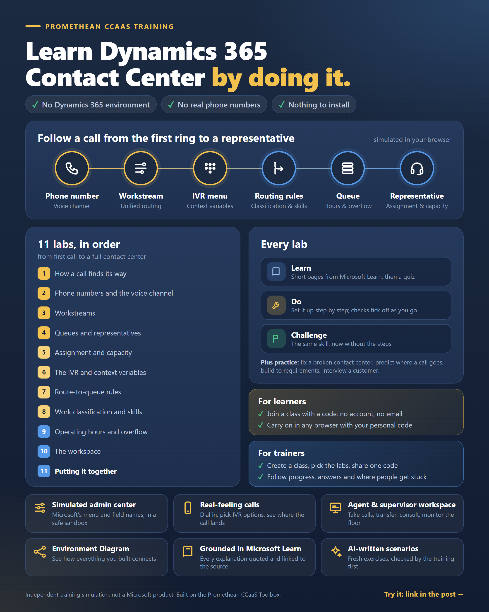

# An environment is not a training: learning Dynamics 365 Contact Center by doing it

You can set up a trial and click around in Dynamics 365 Contact Center. But an empty environment doesn't teach you anything. Where do you start? Why does a call end up in the wrong queue? Did you set up that routing rule right, or does it only look right? A trial gives you the product, not the learning.

That's the gap I wanted to close with **Promethean CCaaS Training**: a hands-on training that tells you what to do and why, and checks what you built.

## A learning path, not a blank page

The heart of the training is a path of 11 labs, in a recommended order. It starts with *How a call finds its way* and builds up through phone numbers, workstreams, queues, assignment and capacity, the IVR, route-to-queue rules, work classification and skills, and operating hours and overflow. It ends with *Putting it together*. Each lab builds on the one before, so you always know what's next.

Every lab has three parts:

1. **Learn**: a few short pages explaining the idea, and a quiz. The explanations quote Microsoft Learn, with a link to the article, so the facts come from the source.
2. **Do**: you set it up step by step, and checks tick off as you go. You know straight away whether you did it right.
3. **Challenge**: the same skill again, now without the steps. This is where you find out whether you really understand it.

## Practice that tests understanding

Next to the labs there are practice exercises that go beyond following steps:
- **Fix a broken contact center**: something is set up wrong, and you have to find and fix it.
- **Where does this call go?**: predict where a call ends up, then see whether you were right.
- **Build to requirements**: a set of requirements, and you decide how to build it.
- **Customer interview**: ask a customer questions to find out what they need, then build it.

Some of these scenarios are written by AI, and the training checks each one before a learner sees it.

## Why it's a simulation

The training runs entirely in the browser, with a simulated admin center, phone, workspace and Environment Diagram. That isn't about avoiding a tenant. It's what makes the learning possible:

- **The training can see what you built**, so it can check your work, give hints and explain what's wrong.
- **Calls just work.** You call your own contact center, pick options in the IVR menu, and take the call as a representative, without phone numbers or licences to arrange. All numbers come from ranges reserved for fiction.
- **Mistakes are safe.** Break it, look at the Environment Diagram to see why, and start again.
- **What you learn carries over.** The admin center uses Microsoft's own menu and field names.

## For trainers

A trainer creates a class, picks the labs and shares one code. Learners join with that code: no account, no email, just a first name. With their personal code they carry on in any browser.

The trainer follows the class as it happens: who is where, how far everyone got, which quiz questions were hardest, and where people get stuck. For a single learner, the trainer sees their answers and can open their environment, read-only, to see what they built. That's the kind of insight a room full of trial environments never gives you.

## How it's built

The training is built on the [Promethean CCaaS Toolbox](https://github.com/ameijers/PrometheanCCaaSToolbox), a set of tools I made for Dynamics 365 Contact Center. Its code runs underneath: the model of the environment, the health checks, the routing evaluator that decides where a call goes, and the Environment Diagram.

## Help me test it

The training is in testing now, and I'd love your feedback. Everything you need is on the testers' page, including a class code you can use: **[TESTERS.md](https://github.com/ameijers/PrometheanCCaaSTraining/blob/main/TESTERS.md)**. Or go straight to the training at https://gray-mushroom-00ea8790f.4.azurestaticapps.net.

Use the **Feedback** button at the top of the training for anything you notice, big or small. It helps the most when you send it from the screen where it happened.

---

*Promethean CCaaS Training is an independent training simulation, not a Microsoft product. Quotes from Microsoft Learn are © Microsoft, under CC BY 4.0.*
